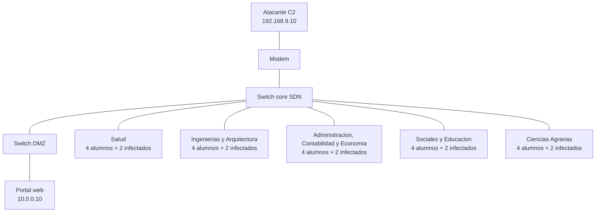

# Detección multi-clase de DDoS en un campus SDN

Laboratorio reproducible de un ataque DDoS contra el **portal web** de una
universidad. La red imita, en chico, la ciudad universitaria de la UNCP:
un modem de borde, un switch core, y un laboratorio por cada área
académica. Corre en Docker, pensado para macOS.

## A quién se ataca

Se ataca el portal web institucional, el host `www` en `10.0.0.10`.

Es la máquina que los alumnos abren para entrar a la intranet, ver
notas, entrar al aula virtual o buscar en la biblioteca. El atacante no
está en el laboratorio: está en internet, del otro lado del modem. Las
computadoras ya infectadas, repartidas en los laboratorios, son las que
le pegan a ese portal. El modem y los switches no son el blanco. El
controlador Ryu tampoco: tumbar el controlador sería otro experimento.

No hace falta un segundo servidor para esta prueba. Si el portal se pone
lento o empieza a responder 503, el alumno lo nota. Más adelante se
podría sumar el controlador como otro blanco; ahora dejaría la comparación
más confusa.

El portal de esta simulación no es el sitio real de la UNCP. Son cinco
páginas fijas. Además es chico a propósito: cada página tarda 0,4 s y
solo atiende 30 conexiones a la vez. Diez PCs infectadas en un laptop no
tiran un servidor de verdad; con ese tope sí se ve el efecto.

## Cómo "navegan" los alumnos

No salen a internet. Cada PC de alumno, en bucle, abre una de estas
páginas del portal y espera como si estuviera leyendo:

| Página | Qué representa |
|---|---|
| `/` | Inicio del portal |
| `/login` | Intranet |
| `/notas` | Registro de notas |
| `/aula` | Aula virtual |
| `/biblioteca` | Biblioteca |

La pausa entre páginas es aleatoria, entre 0,5 y 1,5 s. En el baseline
las PCs infectadas hacen lo mismo: todavía se comportan como alumnos.
Cuando empieza un ataque, esas PCs dejan de navegar y atacan el mismo
portal. Los alumnos de verdad siguen entrando, para poder medir si la
página les responde.

## Topología

Cada switch de facultad es **un laboratorio** de esa área, no toda la
facultad. La UNCP tiene cinco áreas y 22 facultades; meter el campus
entero en Docker no corre.



| Pieza | Cuántos | Dirección |
|---|---|---|
| Modem | 1 | 192.168.9.1 hacia internet, 10.0.0.1 hacia el campus |
| Atacante C2 | 1 | 192.168.9.10 |
| Portal | 1 | 10.0.0.10 |
| Alumnos | 4 por laboratorio, 20 en total | .10 a .13 de su bloque |
| Infectados | 2 por laboratorio, 10 en total | .20 y .21 de su bloque |

Las direcciones distinguen el laboratorio, y todas están en la red `10.0.0.0/8` para que el switch las comunique. El atacante queda fuera, en `192.168.9.0/24`.

| Laboratorio | Direcciones |
|---|---|
| Salud | 10.1.0.10–13 alumnos, 10.1.0.20–21 infectados |
| Ingenierías y Arquitectura | 10.2.0.10–13 y 10.2.0.20–21 |
| Administración, Contabilidad y Economía | 10.3.0.10–13 y 10.3.0.20–21 |
| Sociales y Educación | 10.4.0.10–13 y 10.4.0.20–21 |
| Ciencias Agrarias | 10.5.0.10–13 y 10.5.0.20–21 |

Los switches (core, DMZ y laboratorios) son Open vSwitch con Ryu. El
tráfico de un infectado hacia el portal cruza su laboratorio y el core.
No sale a internet. El C2 solo cruza el modem para llegar a las PCs
infectadas; en el ataque, un ping de ese host representa la orden.

Docker Desktop conviene dejarlo con unos 8 GB de memoria. Open vSwitch
va en userspace: no intentes subir los ritmos a los de un ataque real
de gigabits, porque el emulador se cae antes.

## Qué se mide

Docker ve **un solo contenedor**, no cada facultad. `docker stats` anota
CPU, memoria y bytes de red de todo el campus junto. Eso dice cuánto le
cuesta el escenario a tu Mac.

Lo que siente el alumno se mide dentro de la red, una vez por segundo,
desde la PC `salud-u1`:

| Columna | Qué es |
|---|---|
| `probe_http_code` | 200 si el portal abrió, 503 u otro si no |
| `probe_latency_ms` | Cuánto tardó esa página |
| `server_rx_pps` / `server_rx_bps` | Paquetes y bytes por segundo que entran al portal |
| `server_conns` | Conexiones hacia el puerto 80 |
| `core_flows` | Flujos OpenFlow en el switch core |

Archivos de una corrida:

```
data/raw/<escenario>.pcap
data/raw/<escenario>.meta.json
data/metrics/<escenario>_interno.csv
data/metrics/<escenario>_docker.csv
data/metrics/resumen.csv
data/processed/<escenario>.csv
```

En el CSV de flujos, la columna `Label` sale de la IP, no del archivo
entero. En un ataque, la IP de una PC infectada lleva `synflood`,
`httpflood`, `slowloris` o `icmpflood`. El alumno queda `BENIGN`. En el
baseline todo es `BENIGN`, también las PCs que después atacan.

Qué se espera ver, a este tamaño. En una prueba de 15 segundos ya medida
en esta máquina:

- **baseline:** las 15 sondas del alumno respondieron 200, con latencia media de unos 405 ms (el portal tarda 0,4 s aunque nadie lo ataque) y unos 100 paquetes/s entrando al servidor.
- **httpflood:** las páginas siguieron abriendo, la latencia media subió a 576 ms y el tráfico al portal pasó a unos 420 paquetes/s. El cupo de 30 conexiones se nota en la espera, no siempre en un error.
- **slowloris:** está armado para ocupar esas 30 conexiones y dejar al alumno sin cupo. Si en tu corrida los 200 bajan, es este caso.
- **synflood** e **icmpflood:** suben los paquetes. El ICMP no ocupa un cupo del portal, así que la página puede seguir abriendo.

Para comparar, mira `data/metrics/resumen.csv` (baseline contra el
ataque) y los CSV `*_docker.csv` (si el contenedor pasó de poco CPU a
estar cargado).

## Probarlo en macOS

Hace falta Docker Desktop abierto. Desde la raíz del repositorio:

```bash
bash scripts/docker/run_scenario.sh verify
bash scripts/docker/run_scenario.sh baseline 20
bash scripts/docker/run_scenario.sh httpflood 20
```

`verify` comprueba tres caminos: un alumno llega al portal, un infectado
llega al portal, y el C2 llega a un infectado. También pide una página
y tiene que responder 200. Además comprueba que tu navegador, en
`http://127.0.0.1:8080/`, llega al mismo portal.

## Analizar

No hace falta volver a capturar para leer el resultado de esta corrida:

```bash
bash scripts/docker/preparar_analisis.sh
# o, equivalente y más completo:
.venv/bin/python notebooks/analisis_completo.py
```

Eso reentrena el bosque con los CSV que ya están y escribe
`notebooks/resultados/informe.txt`. La tabla del artículo queda en
`paper/tabla_resultados.tex`. El informe es lo que se lee.

Para armar otra corrida, de 120 segundos, y rehacer ese informe:

```bash
bash scripts/docker/preparar_analisis.sh --capturar
```

## Documento para el encargado + Wireshark

PDFs ya compilados:

- `paper/main_es.pdf` — artículo (español)
- `paper/main.pdf` — artículo (inglés, Software Impacts)
- `docs/protocolo_encargado.pdf` — protocolo corto para el encargado
- `docs/documento_encargado.docx` — versión larga

Para recompilar: `bash paper/compilar.sh both`

### Cuando haya el escaneo / pcap real

```bash
bash usar_datos_reales.sh ~/Descargas/alumnos.pcapng
```

O copia el `.pcap` a `data/real/wireshark/` y corre `bash usar_datos_reales.sh`.

Eso anonimiza, mezcla con los ataques de la simulación, entrena el
modelo y deja `notebooks/resultados/informe_hibrido.txt`. El ataque
**no** se ejecuta contra la red real.

## Mezclar tu tráfico benigno

Tú te conectas. El ataque no sale de Docker: sigue yendo solo al portal
emulado `10.0.0.10`.

Cuando el log diga `Portal benigno listo`, abre en el navegador de tu Mac:

```text
http://127.0.0.1:8080/
```

Sirven las mismas cinco páginas (`/`, `/login`, `/notas`, `/aula`,
`/biblioteca`). Ese tráfico entra como `10.9.0.1`, se mezcla con los
alumnos emulados y, si el escenario es un ataque, con las PCs infectadas.
En un ataque la página puede responder 503: es el efecto que se mide, no
un fallo de la conexión.

La medición dura los segundos que pasaste (20, 120, …) y empieza cuando
la red ya está arriba, cerca de un minuto después de lanzar el script.
Si 8080 está ocupado: `BENIGN_PORT=8081 bash scripts/docker/run_scenario.sh baseline 120`.

Cada corrida queda partida para ver cómo se reparte el enlace:

```text
data/analisis/<escenario>/benigno/trafico.pcap
data/analisis/<escenario>/ataque/trafico.pcap
data/analisis/<escenario>/compartido/reparto.txt
data/analisis/<escenario>/compartido/reparto.csv
data/analisis/<escenario>/compartido/por_ip.csv
data/analisis/<escenario>/compartido/sonda.csv
```

`reparto.txt` dice qué porcentaje enviaron tu navegador, los alumnos y
el ataque. `por_ip.csv` lo desglosa por máquina. La etiqueta del CSV de
flujos no cambia: tu navegador y los alumnos quedan `BENIGN`; la IP
infectada lleva el nombre del ataque.

`baseline 20` y `httpflood 20` duran unos 20 segundos de medición, más
el arranque de la red (puede ser un minuto). La primera vez, si no
existe la imagen `ataque-sdn`, el script la construye y eso tarda
varios minutos.

Los otros ataques, con la misma forma:

```bash
bash scripts/docker/run_scenario.sh synflood 20
bash scripts/docker/run_scenario.sh slowloris 20
bash scripts/docker/run_scenario.sh icmpflood 20
```

O los cinco seguidos (baseline y los cuatro ataques):

```bash
bash scripts/docker/run_scenario.sh all 20
```

Pasar los pcap a CSV (hace falta haber capturado antes):

```bash
bash scripts/docker/run_scenario.sh convert
```

Una corrida de dataset, no de prueba, usa 120 segundos:

```bash
bash scripts/docker/run_scenario.sh all 120
bash scripts/docker/run_scenario.sh convert
```

El script publica la carpeta `data/` del Mac dentro del contenedor y
monta el código de `scripts/mininet`, así que un cambio en esos archivos
vale sin reconstruir la imagen. Hay que reconstruir solo si cambia el
`Dockerfile` (paquetes):

```bash
docker build -t ataque-sdn -f scripts/docker/Dockerfile .
```

## Ritmos del ataque

Cada infectado usa su propia IP. No hay suplantación de origen: si no,
no se puede etiquetar el flujo.

| Escenario | Qué hacen los infectados |
|---|---|
| baseline | Navegan, igual que los alumnos |
| synflood | 20 SYN/s al puerto 80, cada uno |
| httpflood | 4 descargas paralelas del portal, con 0,1 s entre una y la siguiente |
| slowloris | 20 conexiones HTTP lentas, cada uno |
| icmpflood | 20 pings/s, cada uno |

Son 10 infectados, así que el SYN y el ICMP quedan en unos 200 paquetes/s
en total.

## Estructura

```
scripts/mininet/
  roles.py            alumnos, infectados, páginas, ritmos
  topo.py             modem, core, DMZ, cinco laboratorios
  webserver.py        portal con tope de 30 conexiones
  capture_campus.py   un escenario: pcap + métricas
  pcap_to_csv.py      flujos etiquetados por IP
scripts/docker/
  run_scenario.sh     comando de macOS: verify, baseline, ataques, convert
  Dockerfile
paper/                artículo Software Impacts, todavía con TODOs
notebooks/            vacío: aquí iría el entrenamiento
```

## Fases

| Fase | Estado |
|---|---|
| 0–2. Entorno, paquetes, topología de un solo switch | Hecho antes; la topología vigente es el campus |
| 3. Captura de alumnos y de cuatro ataques | Hecho en el campus, listo para probar en Docker |
| 4. pcap a CSV etiquetado por IP | Hecho (`convert`) |
| 5. Entrenamiento | Pendiente (`notebooks/`) |
| 6. Detección en vivo dentro de Ryu | Pendiente |

## Alternativa en WSL2

En Windows, con Ubuntu 24.04 dentro de WSL2 y el venv de Ryu ya creado
(`scripts/wsl/01` a `02`):

```bash
wsl -d Ubuntu -- bash scripts/wsl/03_verify.sh
wsl -d Ubuntu -- bash scripts/wsl/04_capture_normal.sh 20
wsl -d Ubuntu -- bash scripts/wsl/05_capture_attack.sh httpflood 20
wsl -d Ubuntu -- bash scripts/wsl/07_pcap_to_csv.sh
```

En macOS no uses estos scripts: Mininet no corre nativo ahí. Usa Docker.
